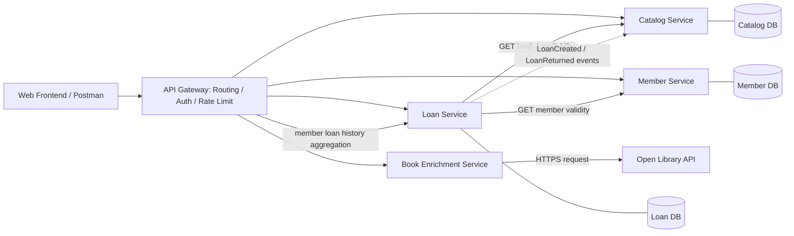

# ออกแบบสถาปัตยกรรม Microservices ของระบบ Library Management System

**รหัสนิสิต:** 67160179  
**ใบงาน:** Week 13 — Microservices Design (CLO1 / CLO8)  
**ฐานการออกแบบ:** Library Management System จาก `project-phase2-67160179-1.zip`  
**ขอบเขต:** เป็น *สถาปัตยกรรมที่เสนอ* ไม่ใช่คำยืนยันว่าได้แยก Deploy เป็น Microservices จริงทั้งหมด

## 1. การแบ่งบริการตาม Bounded Context

แบ่งตามความรับผิดชอบทางธุรกิจ (Business Capability) ไม่แบ่งเป็น Controller/Service/Database ตามชั้นเทคนิค โดย API Gateway ทำหน้าที่เป็นจุดเข้าและ **ไม่นับเป็นบริการธุรกิจ**

| บริการ | ความรับผิดชอบและข้อมูลที่เป็นเจ้าของ | Endpoint หลักที่ออกแบบ | เหตุผลการแบ่ง |
|---|---|---|---|
| **Catalog Service** | ข้อมูลหนังสือ ผู้แต่ง หมวดหมู่ และจำนวนเล่มทั้งหมด; เป็นเจ้าของ Books/Catalog | `GET /api/v1/books`, `GET /api/v1/books/:id`, `GET /api/v1/books/:id/availability` | รายการหนังสือถูกค้น/อ่านบ่อย แยกการขยายระบบจากงานยืมคืน |
| **Member Service** | ข้อมูลสมาชิก การค้นสมาชิก และตรวจสถานะสมาชิก; เป็นเจ้าของ Members | `GET /api/v1/members`, `GET /api/v1/members/:id` (เสนอเพิ่ม), `GET /api/v1/members/:id/loans` (aggregated view ผ่าน Loan) | สิทธิและวงจรชีวิตสมาชิกแตกต่างจากหนังสือและธุรกรรมยืมคืน |
| **Loan Service** | สร้างรายการยืม บันทึกคืน ตรวจสอบกฎการยืม; เป็นเจ้าของ Loans | `GET /api/v1/loans`, `POST /api/v1/loans`, `PATCH /api/v1/loans/:id/return` | ธุรกรรมยืม/คืนต้องตรวจความสอดคล้องและป้องกันยืมเกินจำนวน |
| **Book Enrichment Service** | ดึง metadata หนังสือจาก Open Library และจัดการ timeout/retry/fallback/caching | `GET /api/v1/books/:id/external-info` | API ภายนอกล่มหรือช้าได้ จึงควรแยกความเสี่ยงจาก Catalog หลัก |

**หมายเหตุความตรงกับโค้ด:** `GET /api/v1/members/:id` เป็น endpoint ในแบบออกแบบสำหรับอนาคต ไม่ใช่ endpoint ที่ยืนยันว่ามีอยู่แล้วใน Phase 2; `GET /api/v1/members/:id/loans` เป็นมุมมองรวมข้อมูล โดย Loan Service เป็นเจ้าของข้อมูลยืมจริง ระบบเดิมยังใช้ฐานข้อมูลรวมใน Monolith

## 2. แผนภาพสถาปัตยกรรม (Target Architecture)

ลูกศรทึบ = synchronous HTTP request/response; ลูกศรประ = asynchronous event แบบเสนอ (future target); DB แยกตามบริการเป็นแบบออกแบบเป้าหมาย **ไม่ใช่โครงสร้างฐานข้อมูลที่ติดตั้งแล้ว** โดย Gateway ตรวจสิทธิ/เส้นทาง และบริการปลายทางตรวจสิทธิระดับธุรกิจซ้ำตามสมควร

## 3. รูปแบบการสื่อสารระหว่างบริการ

| จาก | ไป | รูปแบบ | เหตุผล |
|---|---|---|---|
| Client | Gateway | **Synchronous** (HTTP) | ผู้ใช้ต้องได้รับผลการค้น/ยืม/คืนทันที |
| Gateway | Catalog Service | **Synchronous** | ตอบข้อมูลหนังสือและ availability ตามคำขอ |
| Gateway | Member Service | **Synchronous** | คืนรายชื่อ/ข้อมูลสมาชิกให้แบบฟอร์ม |
| Gateway | Loan Service | **Synchronous** | ยืนยันผลธุรกรรมการยืม/คืนพร้อมรหัสรายการ |
| Gateway | Book Enrichment Service | **Synchronous** | UI รอ metadata ภายนอกแบบมีเวลา timeout และ fallback จำกัด |
| Loan Service | Catalog Service | **Synchronous** | ตรวจสถานะหนังสือก่อนยืม; ต้องตัดสินใจทันทีและรับประกันการจองอย่างปลอดภัย |
| Loan Service | Member Service | **Synchronous** | ยืนยันว่ารหัสสมาชิกมีอยู่/ใช้งานได้ก่อนสร้างรายการยืม |
| Loan Service | Catalog Service | **Asynchronous** (proposed `LoanCreated` / `LoanReturned`) | อัปเดต read model / analytics / cache ภายหลัง ไม่ใช้แทนการตรวจและจองจำนวนเล่มก่อนยืม |
| Book Enrichment Service | Open Library API | **Synchronous** (HTTPS) | อ่าน metadata โดยมี fallback เมื่อภายนอกล้มเหลว |

**Consistency:** การป้องกันยืมเกินจำนวนต้องมี atomic reservation หรือ transaction/locking ตามเจ้าของ stock ในระบบจริง การตรวจ `GET availability` อย่างเดียวอาจเกิด race condition; event ใช้กับ projection ที่ยอม eventual consistency เท่านั้น ส่วนระบบ Phase 3 ปัจจุบันยังเป็นฐานข้อมูลรวม

## 4. จุดที่ต้องมี Retry / Timeout / Fallback

| บริการที่เรียก | ปลายทาง | Retry | Timeout | Fallback / เมื่อปลายทางล่ม | เหตุผล |
|---|---|---|---|---|---|
| API Gateway | Catalog (GET) | 1–2 ครั้ง เฉพาะ network/502/503/504 พร้อม exponential backoff | 2–3 วินาที/ครั้ง | ตอบ `503` หรือข้อมูล cache ที่มีป้ายว่าอาจไม่ล่าสุด | GET idempotent จึง retry แบบมีขอบเขตได้ |
| API Gateway | Member (GET) | 1–2 ครั้ง เฉพาะเหตุชั่วคราว | 2–3 วินาที | ตอบ `503` ไม่เดาว่าสมาชิกใช้ได้ | ข้อมูลสมาชิกต้องเชื่อถือได้ |
| API Gateway | Loan (POST/PATCH) | **ไม่ retry อัตโนมัติ** เว้นมี idempotency key | 3 วินาที | ตอบ error ที่ชัดเจน ให้ตรวจสถานะรายการก่อนส่งซ้ำ | ป้องกันสร้างรายการยืมหรือคืนซ้ำจากคำขอที่อาจสำเร็จไปแล้ว |
| Loan Service | Catalog (ตรวจและจองเล่ม) | ไม่ retry การจองถ้าไม่มี idempotency key | 2 วินาที | ปฏิเสธยืมชั่วคราว (`503`) | ถ้ายืนยัน stock ไม่ได้ต้อง fail closed |
| Loan Service | Member (ตรวจสมาชิก) | Retry 1 ครั้งเฉพาะ GET ที่ล้มเหลวชั่วคราว | 2 วินาที | ปฏิเสธสร้าง loan ชั่วคราว (`503`) | หลีกเลี่ยงยืมโดยข้าม validation |
| Book Enrichment | Open Library | Retry สูงสุด 2 ครั้ง สำหรับ GET เมื่อ timeout/5xx/429 ตาม Retry-After | 3 วินาทีต่อครั้ง + เพดานรวม | คืนข้อมูลท้องถิ่น / cache พร้อม `FALLBACK` | บริการภายนอกไม่ควรทำให้การค้นหนังสือหลักล่ม |
| Gateway | บริการใด ๆ | ไม่ retry 400/401/403/404 | มี timeout ตาม route | `503 SERVICE_UNAVAILABLE` ที่มีความหมาย | ลด request ค้างและไม่ซ่อน validation errors |

**เงื่อนไข:** การ retry ต้องจำกัดจำนวนและมี jitter/backoff; POST ไม่ retry โดยไม่มีกลไก idempotency และให้ระบบรายงานสถานะจริงแทนการกล่าวว่ายืมสำเร็จ ทั้งหมดเป็นข้อเสนอการออกแบบ Week 13 ส่วนเวลาที่แน่นอนสามารถปรับหลังวัด latency จริง

## 5. ความเชื่อมโยงโครงงาน Phase 2 → Week 13 → Phase 3

- Phase 2 ใช้ Node.js/Express REST API และ `src/services/external-api.js` สำหรับข้อมูลหนังสือภายนอก
- Week 13 **ออกแบบ** การแยก bounded contexts และ API Gateway ตามเกณฑ์ข้อ 3.2 (ไม่จำเป็นต้องแยกโค้ดจริง)
- Phase 3 มีหน้า Frontend, routes หนังสือ/สมาชิก/ยืมคืน และ service modules; ควรเก็บไฟล์นี้เป็นหลักฐานการออกแบบ และไม่อ้างว่ามี gateway / ฐานข้อมูลแยกจริงจนกว่าจะพัฒนาและทดสอบ

## 6. ตรวจสอบเกณฑ์ใบงาน

| เกณฑ์ | หลักฐานในไฟล์ |
|---|---|
| อย่างน้อย 3 Bounded Context | §1 (4 บริการธุรกิจ) |
| Gateway และทิศทางการเรียก | §2 Mermaid diagram |
| Sync / Async พร้อมเหตุผล | §3 ตารางการสื่อสาร |
| Retry / Timeout / Fallback | §4 ตาราง resilience |
